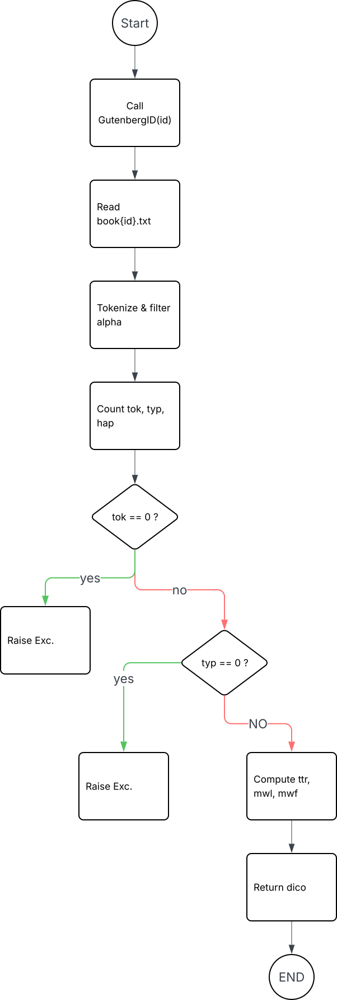
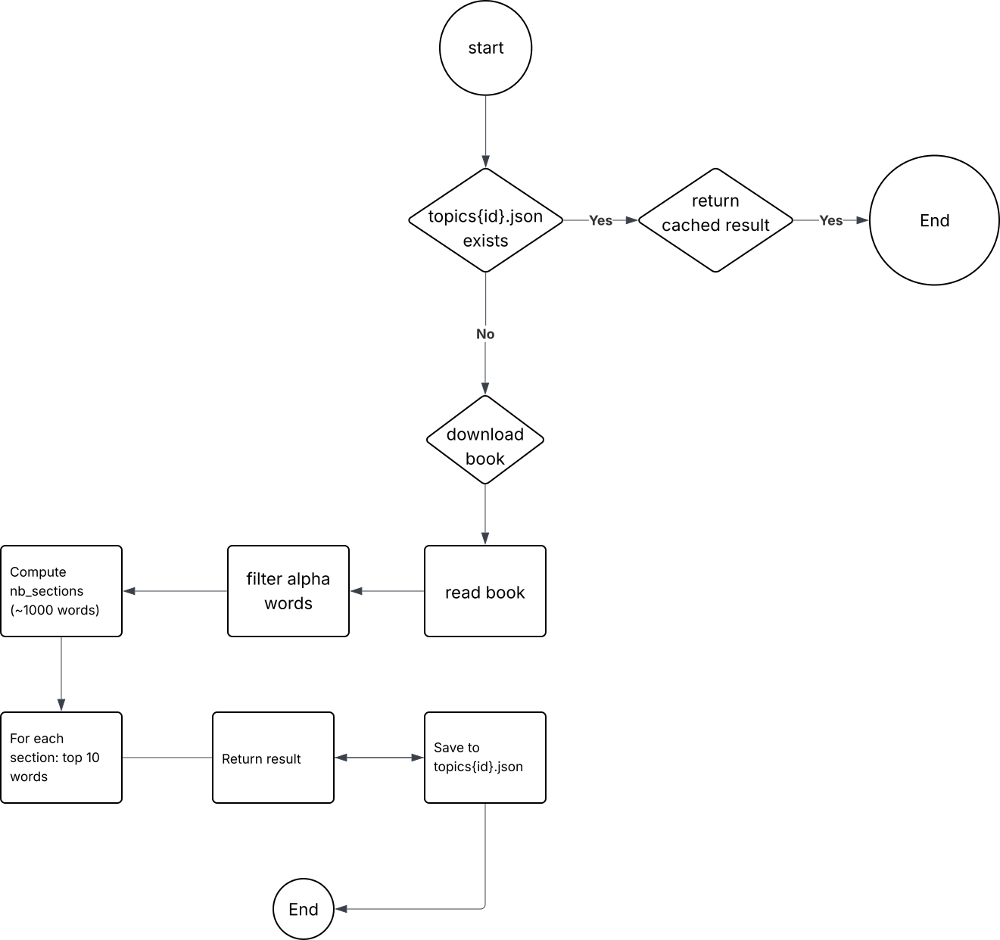
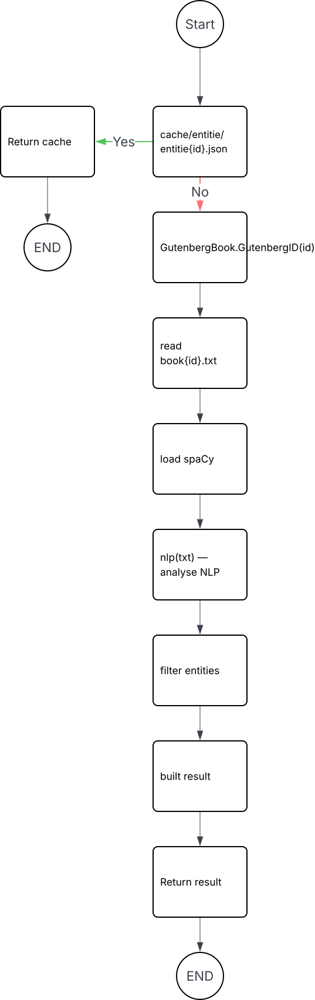

# Alice in Wonderland
This project was made for Epitech. The goal is to build a CLI using NLP techniques. 

We work with the Project Gutenberg website to download books and their catalog.

## Contents
- `bookworm.py` — main CLI script containing all NLP logic
- `cache/book/` — downloaded and cleaned Gutenberg `.txt` files
- `cache/pg_catalog.csv` — local copy of the Project Gutenberg catalog `.csv`
- `cache/summary/` — cached summaries per book ID `.txt`
- `cache/topics/` — cached topic results per book ID `.json`
- `cache/entitie/` — cached entity results per book ID `.json`
- `requirements.txt` — all Python dependencies

## How to use
1. Clone the repository.
```
git clone <repo-url>
```
 
2. Create a virtual environment.
```
python -m venv venv
source venv/bin/activate
```
 
3. Install dependencies.
```
pip install -r requirements.txt
```
 
4. Run a command.
```
python bookworm.py --lexdiv 11
python bookworm.py --entities 11
python bookworm.py --summarize 11
python bookworm.py --topics 11
python bookworm.py --similar 11
python bookworm.py --card 11
```

## CLI Reference

 Option | Argument | Description |
|---|---|---|
| `--lexdiv` | `<ID>` | Compute lexical diversity metrics for a book |
| `--entities` | `<ID>` | Extract named characters and locations |
| `--summarize` | `<ID>` | Generate  summary |
| `--topics` | `<ID>` | Extract top keywords per section |
| `--similar` | `<ID>` | Find the 5 most similar books in the corpus |
| `--card` | `<ID>` | Return a full metadata card combining all of the above |

## NLP Tasks

### Lexical Diversity


### Topic Modeling


### Named Entity Recognition


## Credits
 
This project was made by [MelioSousLo](https://github.com/MelioSousLo), and [Kenan-LCF](https://github.com/Kenan-LCF).